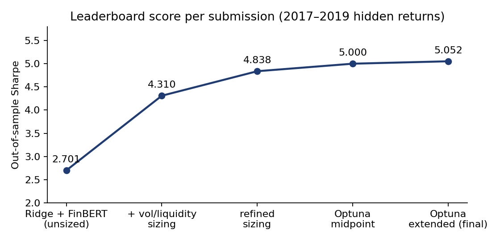
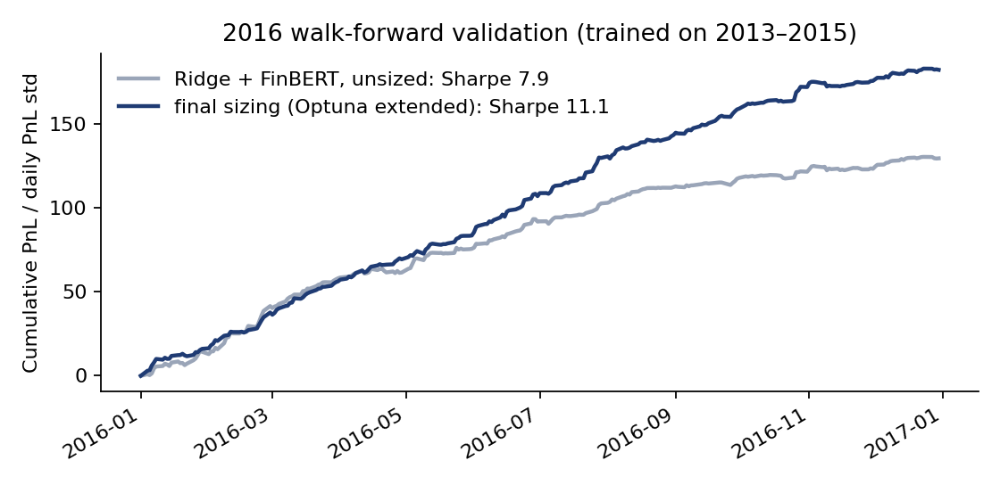

# HRT Algo Arena: news-driven return prediction (1st of 24 teams)

Winning submission to **HRT Algo Arena**, a live trading challenge run by Hudson River Trading and The Finance Association at EPFL (October 2026). The task: predict the market-adjusted return of a stock after a Bloomberg headline. Predictions were scored on hidden 2017–2019 returns by the annualized Sharpe ratio of a simple headline-driven trader.

**Final out-of-sample Sharpe: 5.052, ranked 1st of 24 teams.**



## Problem

| | |
|---|---|
| Input | One row per headline: text, symbol, timestamp, stock volatility `vol`, average daily notional `adn`, past-hour and past-day returns, topic tags |
| Training data | 136,594 headlines, 2013–2016, with realized market-adjusted returns |
| Test data | 27,864 headlines, 2017–2019, returns hidden |
| Output | One real number `pred` per headline (sign = direction, magnitude = conviction) |
| Score | `sqrt(252) * mean(daily PnL) / std(daily PnL)`, with `PnL = pred * return * weight` summed per day and `weight = min(sqrt(adn), 50000)` |

Since the score is a Sharpe ratio, multiplying every prediction by the same constant changes nothing. What matters is the direction of each bet and its size *relative to the other bets*. The solution therefore has two separate parts: a return model and a sizing rule.

## Approach

**1. Return model: Ridge regression on headline text, with FinBERT features.**

- TF-IDF on word 1–3-grams (`min_df=5`, 100k features, sublinear TF).
- Past-hour and past-day returns, normalized by stock volatility (floored at the training 5th percentile) and clipped to ±3.
- Interaction terms (TF-IDF × normalized past return, strength 0.25), so a phrase can mean something different after a rally than after a selloff.
- [FinBERT](https://huggingface.co/ProsusAI/finbert) positive / negative / neutral probabilities, standardized and down-weighted by 0.1. They are features for the regression, not a standalone signal: raw FinBERT sentiment on its own scored far below the text model.
- Ridge, `alpha=100`, fitted on the realized return.

**2. Sizing: volatility and liquidity scaling.**

The raw forecast is multiplied by

```
m = clip( (median_vol / vol)^a * (weight / median_weight)^b , lower, upper )
```

with medians and floors taken from training data only. The final parameters were `a = 1.36`, `b = -1.32`, `lower = 0.18`, `upper = 9.45`. A negative `b` undoes most of the evaluator's `sqrt(adn)` weighting: it shifts exposure toward less liquid names, where headlines carry more information. This was the largest single gain, both in validation (Sharpe 7.6 → 11.4) and on the leaderboard (2.70 → 4.84).

The sizing parameters were tuned with Optuna (TPE, 1,200 trials), then the top 12 candidates were re-verified on fresh resamples (details below).

## Validation protocol

- **Walk-forward by year.** Fit on all years before year *Y*, validate on *Y*. Model and sizing choices were selected on 2014 and 2015. 2016 was used only as a follow-up check, and is reported as previously seen, not as a pristine holdout.
- **Test data never used for fitting or tuning.** The only test-set statistic used is the number of headlines per day (see below).
- **Density matching.** The test set has about 36 headlines per day, against about 135 in training. Fewer independent bets per day means a lower daily Sharpe, so in-sample validation numbers overstate the attainable score by roughly `sqrt(135/36) ≈ 1.9×`. Validation therefore also scores each candidate on random subsamples thinned to test density. The Optuna objective is `mean - 0.15 * std` of that density-matched Sharpe across 48 fixed masks per year, and the top 12 trials were re-checked on 256 fresh masks to avoid selecting on mask noise.
- **Paired block bootstrap** (5/10/20-day blocks, 10,000 replicates) on daily PnL to check whether a change beats the incumbent by more than noise.



The density-matched 2016 Sharpe of the refined sizing was 6.5 (range 4.0–9.2 over 200 subsamples). Its leaderboard score of 4.84 falls inside that range.

## Results

| Submission | Change | Validation Sharpe (2014/15 mean) | Leaderboard |
|---|---|---|---|
| `ridge_finbert` | Ridge + FinBERT, unsized | 7.59 | 2.701 |
| `ridge_finbert_sized` | inverse-vol × liquidity^-0.5 sizing | 10.09 | 4.310 |
| `ridge_finbert_sized_v2` | liquidity exponent -1.0, bounds [0.25, 4] | 11.41 | 4.838 |
| `optuna_midpoint` | midpoint between v2 and Optuna parameters | 11.71 | 5.000 |
| `optuna_extended` | Optuna-selected sizing (**final**) | 11.80 | **5.052** |

What did not help (all decided on 2014/2015 validation): ElasticNet instead of Ridge, an ElasticNet/Ridge blend (+0.02 Sharpe, within noise), clipping predictions, liquidity filters (dropping illiquid names cost up to 4 Sharpe), price-only mean-reversion signals (Sharpe below 1 in the 2015 selection year), and a constant offset on predictions.

Full experiment log: [docs/methodology.md](docs/methodology.md).

## Repository layout

```
src/
  research_*.py        experiments; each writes to src/<name>_results/
  make_*.py            build submission CSVs from frozen selections
  *_results/           metrics, selections, bootstrap tables, Optuna trials
docs/
  methodology.md       full experiment log and design decisions
  figures/
```

Every research script reads training data only, unless stated otherwise in its docstring, and writes its selection to `selection.json` before computing the 2016 check. The `make_*` scripts refuse to run if the selection they expect does not match, and verify each written CSV by reading it back.

## Reproducing

The competition data (`df_ins.pkl`, `df_oos.pkl`), HRT's helper module `news.py` and the starter notebook were provided to participants and are **not included**. The headlines are licensed Bloomberg content.

```sh
python3 -m venv .venv && source .venv/bin/activate
pip install -r requirements.txt
# place news.py, df_ins.pkl, df_oos.pkl in src/

# return model
python src/research_baselines.py
python src/research_ridge_tuning.py
python src/research_finbert_cache.py --download
python src/research_finbert_cache.py                # training headlines
python src/research_finbert_cache.py --dataset oos  # test headlines, inference only
python src/research_finbert_elasticnet.py finbert
python src/make_ridge_finbert_csv.py                # predictions_ridge_finbert.csv

# sizing
python src/research_exposure_sizing.py && python src/make_sized_csv.py
python src/research_sizing_refinement.py && python src/make_refined_sized_csv.py
python src/research_optuna_sprint.py
python src/research_optuna_extended.py             # predictions_optuna_extended.csv (final)
```

FinBERT runs locally (CPU or Apple MPS); no headline is sent to an external service. The Optuna stages have wall-clock timeouts, so a re-run can explore a slightly different set of trials. Re-running `make_ridge_finbert_csv.py` and applying the frozen final sizing from `src/optuna_extended_results/selection.json` reproduces the submitted predictions to within 1e-8 relative error.

## Team

- Jens Cancio ([@jnsxio](https://github.com/jnsxio))
- TODO: teammate names

## License

Code under the MIT License (see `LICENSE`). Competition data and HRT's starter materials are not covered and not redistributed.
